# PhD RAG — user manual

This is the manual for the local interface. The default screen is a **simple chat** with saved
conversations and file attachments (RAG-015), where the **Model** list chooses whether the next
message is answered by the local model or by the DeepSeek API (RAG-016); the five academic
working modes added in RAG-014 are still there, behind the **Advanced** button in the top bar.

If you only read one paragraph: **start it with one command, type in the box at the bottom, and
press Send.** Attach a document when you want to work on one. Open **Advanced** when you want
the academic modes: there, the literature in your corpus is the only thing allowed to support a
scholarly claim, your own drafts, your supervision notes and your writing rules are never cited,
and papers found on the Internet are shown as metadata only.

---

## Contents

1. [In thirty seconds](#1-in-thirty-seconds)
2. [Before the first run](#2-before-the-first-run)
3. [The screen](#3-the-screen)
4. [The five modes (Advanced)](#4-the-five-modes-advanced)
5. [How to read a result](#5-how-to-read-a-result)
6. [Advanced options](#6-advanced-options)
7. [Copying into your thesis](#7-copying-into-your-thesis)
8. [Everyday recipes](#8-everyday-recipes)
9. [Troubleshooting](#9-troubleshooting)
10. [What this tool does not do](#10-what-this-tool-does-not-do)
11. [Privacy and where things live](#11-privacy-and-where-things-live)
12. [The same tasks from the command line](#12-the-same-tasks-from-the-command-line)

---

## 1. In thirty seconds

```powershell
cd F:\phd-rag
.\.venv\Scripts\python.exe -m app.web
```

Then open <http://127.0.0.1:8000/> in your browser. Type in the composer at the bottom, press
**Send** (`Ctrl+Enter` sends too). Your conversations are saved on the left; a new one starts
with **+ New chat**. **Attach** adds a PDF, DOCX, TXT or Markdown file to the conversation you
are in. Nothing leaves your machine unless you pick DeepSeek in the **Model** list, which is
off until you give it a key.

For the academic modes — Evidence, Writing, Consistency, Supervisor, Research — click
**Advanced** in the top bar.

## 2. Before the first run

Two things must be up before a run can produce an answer; the status bar at the top of the
page tells you whether they are.

| What | How you know it is ready | If it is not |
|---|---|---|
| **Ollama**, with the model you configured | the status bar shows `Ollama 0.35.1 · qwen3.5:35b` | start Ollama (`ollama serve`), or install the model (`ollama pull qwen3.5:35b`) |
| **The corpus index** | the status bar shows `phd_rag_chunks_v1 · 11,469 points` | build it with the RAG-008 indexing command (see the README) |

Optionally, **DeepSeek** as a second and third model to answer the chat with: set
`DEEPSEEK_API_KEY` before starting the interface (see the README for the exact commands) and the
cloud entries in the **Model** list become selectable (*DeepSeek V4.1 Flash* and *DeepSeek V4
Pro* by default). Without a key the list still shows them, greyed out, and the chat is
local-only.


Three notes that save time later:

* **The first run is slow** (10–20 seconds). That is when the embedding model, the
  re-ranking model and the index connection are loaded. Every run after it in the same
  session takes a couple of seconds. Chatting does not need those models at all: only
  "consult the PhD corpus" and the Advanced modes do.
* **The interface holds the index open.** A local Qdrant store can only be used by one
  process at a time, so a CLI command that reads the same index will fail while the
  interface is running. Stop the interface (Ctrl+C in its window) before running CLI tools
  against `.qdrant_data` — or see [Troubleshooting](#9-troubleshooting).
* **Conversations live in `data\chat\`** — a SQLite file and a folder of attachments. They
  are never added to `data\literature` or `data\my_work`.
* **DeepSeek is optional and needs a key.** Set `DEEPSEEK_API_KEY` before starting the
  interface to make the cloud entry usable (see the README). Without it, the chat is local-only
  and nothing about it changes.

## 3. The screen

The default page is the chat:

| Area | What it is for |
|---|---|
| **Left sidebar** | **+ New chat**, then every saved conversation, most recently used first. Click one to reopen it; the highlighted row is the one you are in |
| **Chat header** | the conversation's name, with **Rename** and **Delete** |
| **Conversation** | your messages and the model's answers, oldest first |
| **Attachment chips** | the files attached to this conversation, with how much text was read. The `×` detaches one |
| **Composer** | **Attach**, your message, **Send**. `Ctrl+Enter` sends; the checkbox asks for the permanent corpus; the **Model** list chooses who answers the next message |
| **Context and debug** (collapsed) | how the context window was spent on the last answer, including anything left out |
| **Advanced** (top bar) | the RAG-014 screen: the five modes, the advanced options and the result panels |

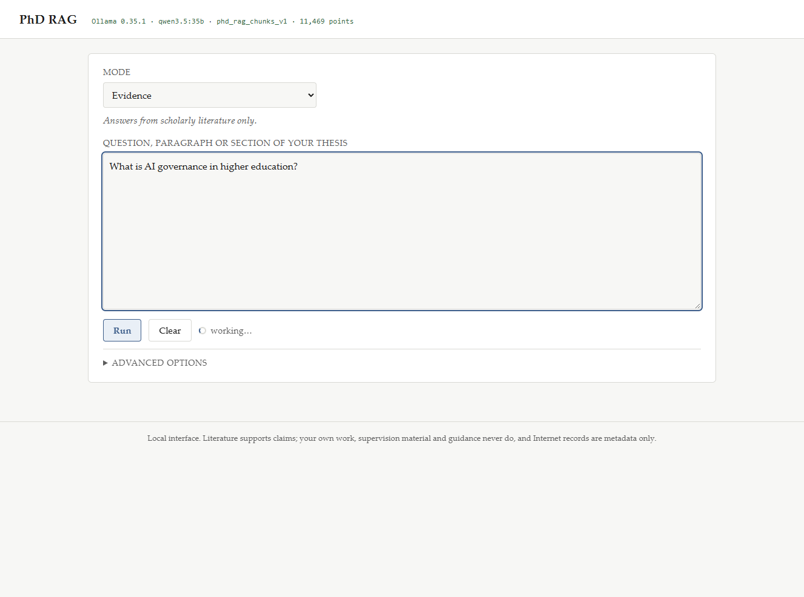

### 3.1 Chatting

Chat is ordinary conversation, not a mode. You can say "read this first", "don't rewrite yet,
give me three observations", "now rewrite only the second paragraph", and it will do what you
asked. It does not add citation markers, references or validation unless you ask for them.

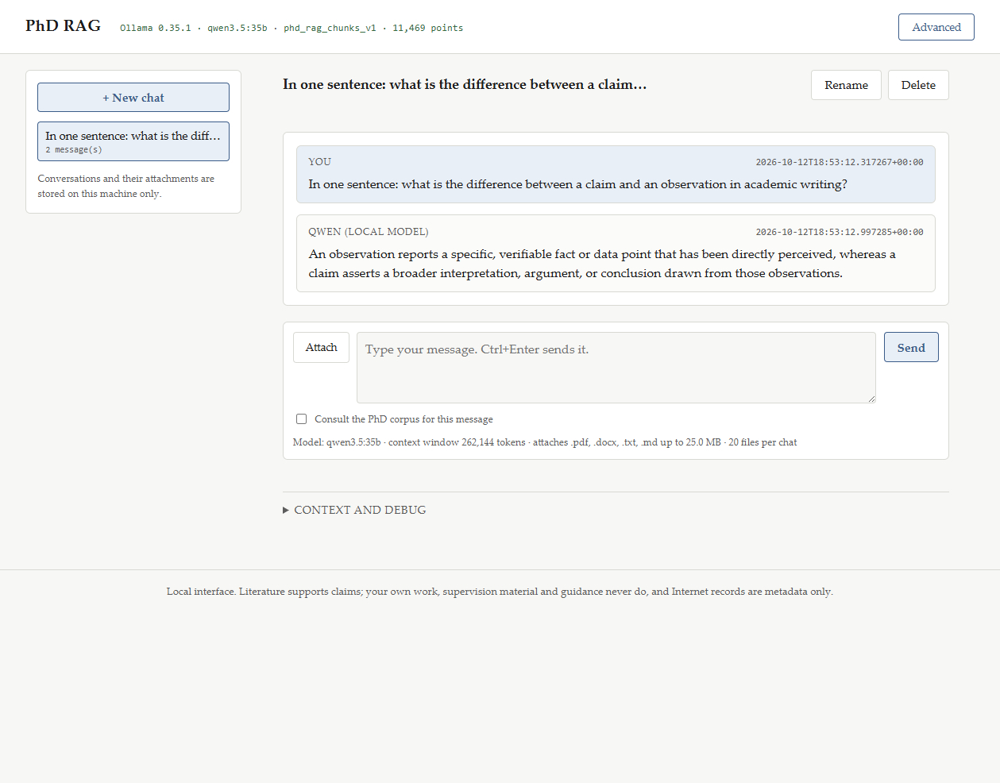

Two things are worth knowing:

* **Attached files are working documents for that conversation.** Their text is stored with the
  chat, so reopening it needs no re-upload. They are *not* added to your corpus, not embedded,
  and not treated as scholarly evidence.
* **The permanent corpus is asked for, not assumed.** Tick *Consult the PhD corpus*, or ask in
  words ("what does the literature say about …", "search my corpus for …"), and the answer is
  built from your corpus as well. Corpus excerpts arrive labelled: `evidence` may support a
  claim, `my_work` is your own writing, `guidance` is supervision and rules material, and none
  of the last two are evidence.

The context window is large (262,144 tokens), and the model is given whole documents wherever
they fit. When something does not fit, it is listed under **Context and debug** — a document is
cut at a paragraph boundary and says so, never in the middle.

If a turn fails to produce an answer, the notice offers **Retry this turn**: the answer is
generated for the message that is already in the conversation, so your words are never sent
twice and the history keeps one user turn per turn. A failure that Ollama itself reports as a
repeated-token abort is retried once automatically, with a fresh model load, before you see it —
and when that happens it says so under **Context and debug**.

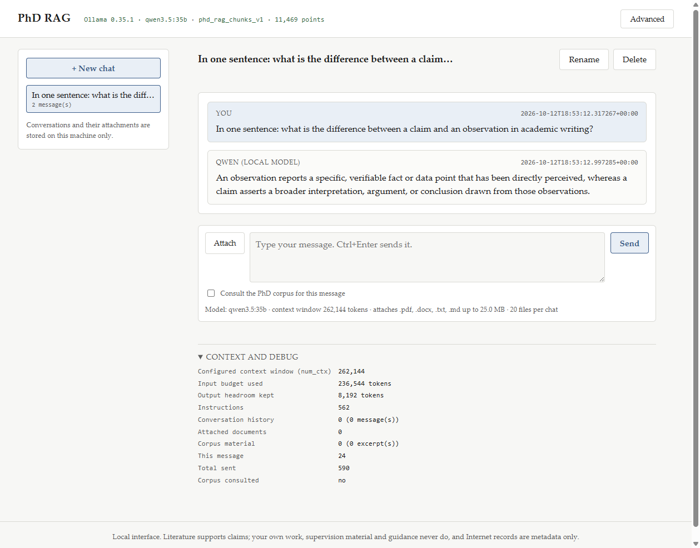

### 3.1.1 Choosing the model per message

The **Model** list in the composer chooses who answers the *next* message. It applies to that
message only: the conversation is not bound to one model, and switching never starts a new chat
or changes what is already stored.

```
Local
  Qwen 3.5 35B          🔒 Local     processing stays on this computer; the default
DeepSeek
  DeepSeek V4.1 Flash   ☁ Cloud      the everyday cloud model
  DeepSeek V4 Pro       ☁ Cloud      the slower, stronger one, chosen by hand
```

The line under the list repeats which model you are about to use, and the window it works in.
Messages already in the conversation keep a small badge showing the model that wrote them (🔒 for
the local model, ☁ for a DeepSeek model), so a conversation that used several is still readable
afterwards.

Three things follow from that:

* **Nothing is sent anywhere unless you choose it.** A local turn stays local: your question,
  your attachments and any retrieved corpus excerpts never leave the machine. Choosing a
  DeepSeek model sends *only what this one message needs* — the instructions, the relevant part
  of the conversation, the attached documents' text and the corpus excerpts retrieved for this
  message. Your corpus, your index and your other files are not uploaded.
* **Changing model mid-conversation keeps the thread.** The next model reads the same saved
  conversation, whoever wrote each earlier answer — switching between Flash and Pro included.
* **Retry answers the message that is already there.** If Ollama fails, switch the list to a
  DeepSeek model and press **Retry this turn**; if DeepSeek fails, switch back and do the same.
  The failed turn is answered once, for the user message already in the conversation — nothing is
  typed again and no duplicate appears. There is no automatic fallback in either direction, so
  your material is never sent to the cloud because a local run failed.

DeepSeek needs an API key on the server (see [Before the first run](#2-before-the-first-run)):
without one, the entries are shown as unavailable and cannot be selected. The key is never sent
to the page. Which DeepSeek models the list offers comes from the configuration
(`DEEPSEEK_MODEL` and `DEEPSEEK_MODELS`, see the README); by default it is *DeepSeek V4.1 Flash*
and *DeepSeek V4 Pro*.

When DeepSeek answers, **Context and debug** also reports what the provider itself returned —
model, input tokens, cached input tokens, output tokens, reasoning tokens (a count only),
latency and its request id. Numbers the provider did not report are simply absent; nothing is
estimated or priced.

### 3.2 The advanced screen

Click **Advanced** in the top bar to get the RAG-014 mode interface described in §4 onwards.
Everything there is unchanged: the five modes, the advanced options, sources, external
discoveries, validation details and the audit panel. Click **Back to chat** to return; your
conversation is exactly where you left it.

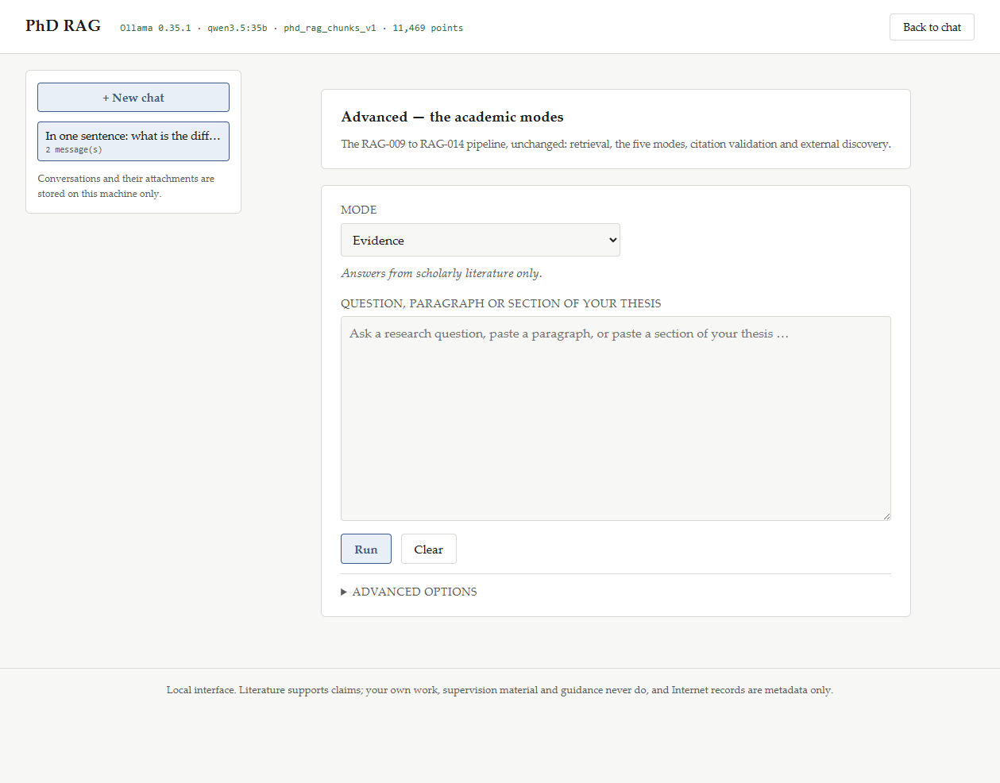

## 4. The five modes (Advanced)

Each mode is a different promise about what the material may do. Pick by *what you want*:

| I want to… | Mode |
|---|---|
| answer a question from the literature | **Evidence** |
| draft prose that is grounded in the literature and consistent with my own work | **Writing** |
| check what I already wrote against the literature and my rules | **Consistency** |
| see what my supervision and guidance material says | **Supervisor** |
| find papers, in my corpus and on the Internet, kept apart | **Research** |

While a run is in flight the Run button is disabled and the status line under it names the mode
and what it is doing — retrieval first, then the model, then validation:

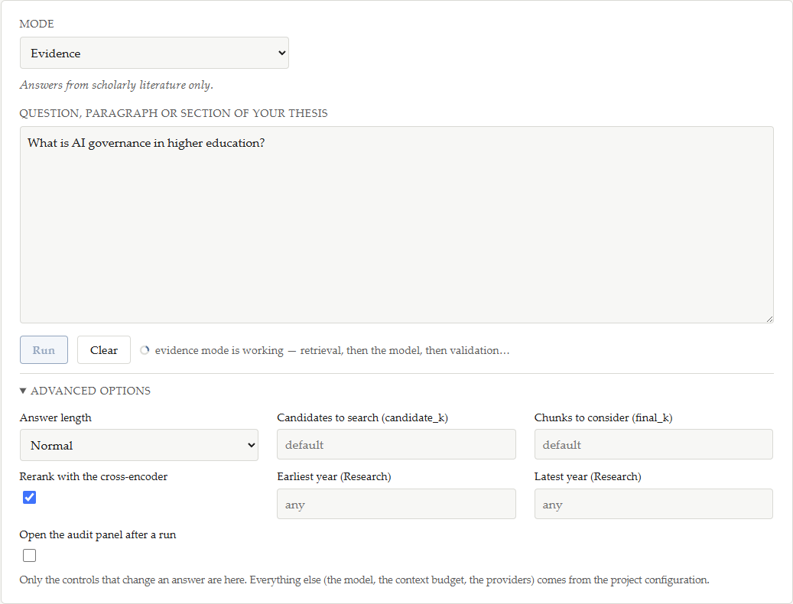

### 4.1 Evidence — answers from the literature

**Use it for:** "what does the literature say about X?", a definition, a summary you will
cite, a first pass before you read the papers yourself.

**What to type:** a research question. `What is AI governance in higher education?`

**What you get:** a validated answer in which every claim sentence carries a Harvard
citation, a deduplicated reference list, and a claim-by-claim audit showing what each
sentence rests on.

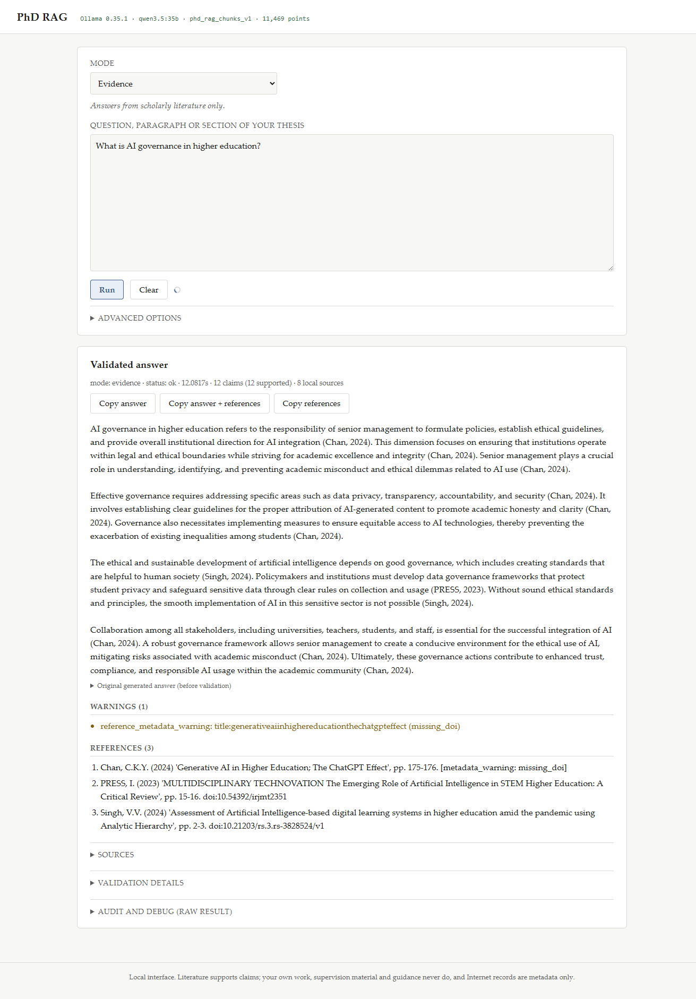

Only literature from your corpus can support these claims. RAG-011's original answer, with
its internal `[S1]` markers, is kept in a collapsed panel so you can see what the model wrote
before validation.

If a claim could not be supported, it is **withheld** rather than published: the sentence is
replaced by `[claim withheld: the cited source does not support it]` and listed in the
warnings. Partially supported and uncertain claims keep their citation with a visible
`[partially supported]` or `[unverified]` annotation.

### 4.2 Writing — drafting grounded prose

**Use it for:** a paragraph you intend to keep, where you want both the literature and your
own existing text in view.

**What to type:** an instruction or a paragraph to continue. `Write a short PhD paragraph on
AI governance in higher education.`

**What you get:** the same validated, cited answer as Evidence, but with two extra sources in
the context: your own draft (for terminology and continuity) and your writing rules. Neither
is ever cited — the sources panel labels them *context only* and *instructions only*, and the
citation map contains no reference to them.

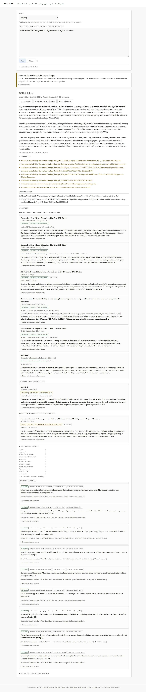

Because your draft and the rules take up room, the model may not fit every retrieved source;
when that happens a notice says so and the warnings list the sources that were dropped.

### 4.3 Consistency — my work against the literature

**Use it for:** "does what I wrote agree with the literature?", "am I using a term nobody else
uses?", "is this paragraph repeating something I wrote last month?", "does this sentence have
any support?"

**What to type:** the text to check — a sentence, a paragraph, or a pasted section of your
thesis — or a question about it. `Compare my treatment of AI governance with the literature.`

**What you get:** a deterministic comparison, grouped into five kinds of finding. No model is
asked to judge your writing, and nothing is rewritten for you.

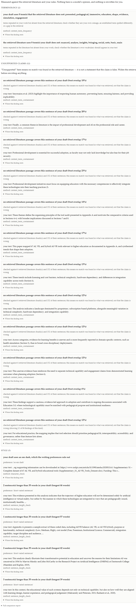

| Group | What a finding means |
|---|---|
| **Terminology** | a content word you repeat that the retrieved literature does not use (or the reverse) — worth checking whether it is your own coinage, a differently spelled established term, or a gap in what was retrieved |
| **Duplication** | two of your passages that cover the same material, or a passage that is largely contained in a retrieved paper (a close paraphrase to check) |
| **Unsupported claims** | a substantive sentence of yours that no retrieved literature sentence covers. This means *no match was found in what was retrieved* — it is **not** a statement that the claim is false |
| **Numeric discrepancies** | a figure in your text where the closest literature passage states figures of the same kind but not that value |
| **Style** | em dash, promotional language, sentences longer than 35 words — checked against your rules document when one was retrieved, otherwise against the built-in preference list |

Every finding names the method that produced it and the chunks it rests on, so you can argue
with it. Findings are capped at twelve per group; when the cap is reached the last finding
says so ("showing 12 of 85 findings of this kind").

### 4.4 Supervisor — what my guidance says

**Use it for:** checking what your supervision notes, progress reviews, future-chapter plans
and writing rules say about a topic, without those notes ever being presented as evidence.

**What to type:** `What guidance do I have about methodology?`

**What you get:** labelled excerpts — `[supervision]`, `[guidance]`, `[rules]`,
`[future_chapters]` — with the file, section and pages for each, under a banner that says the
material is your own scaffolding: not scholarly evidence, never cited, and unable to support a
claim about the literature.

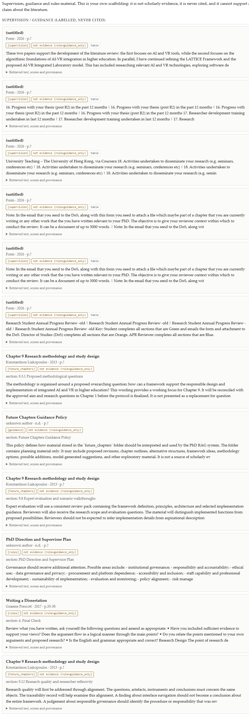

### 4.5 Research — my corpus and the Internet

**Use it for:** finding out what exists, before deciding what to read.

**What to type:** `Find recent papers about AI governance in universities.`

**What you get:** five sections, always separate, never merged into one ranking:

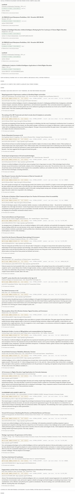

| Section | Meaning |
|---|---|
| **LOCAL EVIDENCE** | what your corpus has, ranked |
| **NEW EXTERNAL PAPERS** | found online, identity verified, and not in your corpus |
| **ALREADY IN CORPUS** | the providers returned a work your corpus already holds |
| **POSSIBLE MATCHES** | found online but identity is not verified, or the providers disagree |
| **CONFLICTS** | the providers contradict each other about the same work; nothing is resolved silently |

Every external card is badged **NOT IN LOCAL CORPUS** or **ALREADY IN CORPUS**, and always
**metadata only — never evidence**. Each card shows title, authors, year, venue, publisher,
DOI, which providers returned it, its verification status, its open-access and full-text
status, an abstract preview when one was supplied, and a provenance panel.

An empty section is shown as `(none)` rather than hidden: "no verified-new papers" is a
result you need to see.

## 5. How to read a result

Reading a result in the order the page presents it is the quickest way to know how much to
trust it.

| Part | What it tells you | Look at it when |
|---|---|---|
| **Meta line** (under the title) | mode, status, how long it took, how many claims were supported, how many local sources and external records | always, first |
| **Notice** (coloured box) | the one thing the run needs you to know: a withheld claim, a provider outage, a context budget cut, a model problem | whenever it appears |
| **Answer** | the validated prose, or the mode's report | always |
| **Warnings** | everything the pipeline wants on the record (metadata gaps, dropped sources, non-citable context) | before you cite anything |
| **References** | the deduplicated bibliography, one entry per work, with `metadata_warning` flags where metadata is missing | before you paste it into your thesis |
| **Sources** (collapsed) | every local block with the role it was allowed to play: `[evidence]`, `[your own work]`, `[context only]`, `[instructions only]`, `[guidance only]` — plus scores, chunk id, document id and provenance | when you want to see the actual passage |
| **External discoveries** (collapsed) | RAG-010 records for the query, kept apart from your corpus | in Research mode |
| **Validation details** (collapsed) | the counts (claims, supported, withheld, markers replaced, references) and one card per claim sentence with its verdict, method, confidence, citation and per-source coverage | when a claim looks surprising |
| **Audit and debug** (collapsed) | the whole structured result as JSON, including the retrieval and generation audit | for debugging, or to see exactly what was searched |

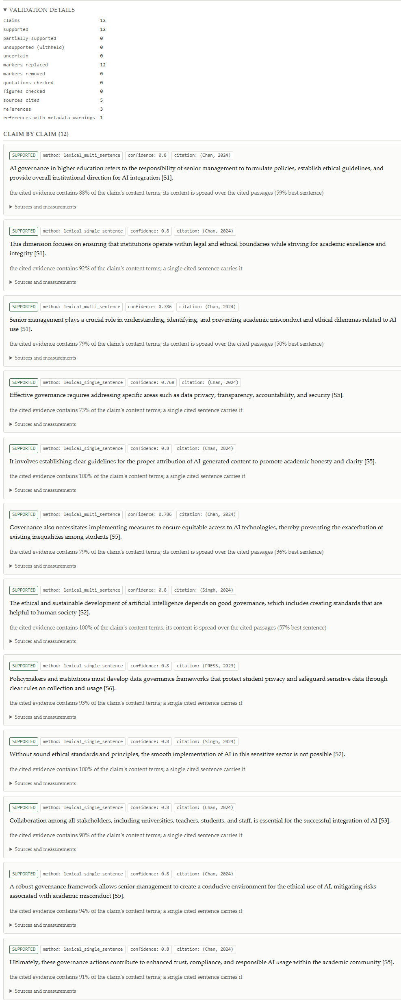

One habit worth forming: **expand Sources and check the role badges** before you use an answer
in your thesis. If every cited source says `evidence (role=evidence)`, you are fine. The tool
will not let a non-evidence block be cited, but seeing it is how you keep your own trust in it.

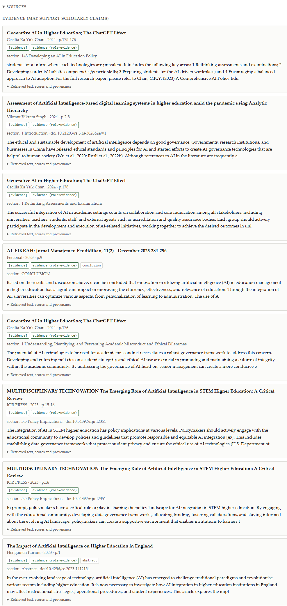

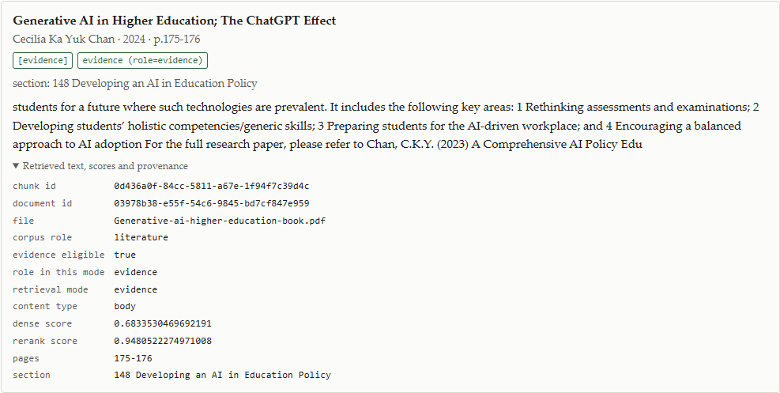

## 6. Advanced options

Collapsed by default, and only the controls that change an answer are there. Options that do
not apply to the selected mode are hidden automatically (answer length disappears in
Consistency, the year range appears only in Research).

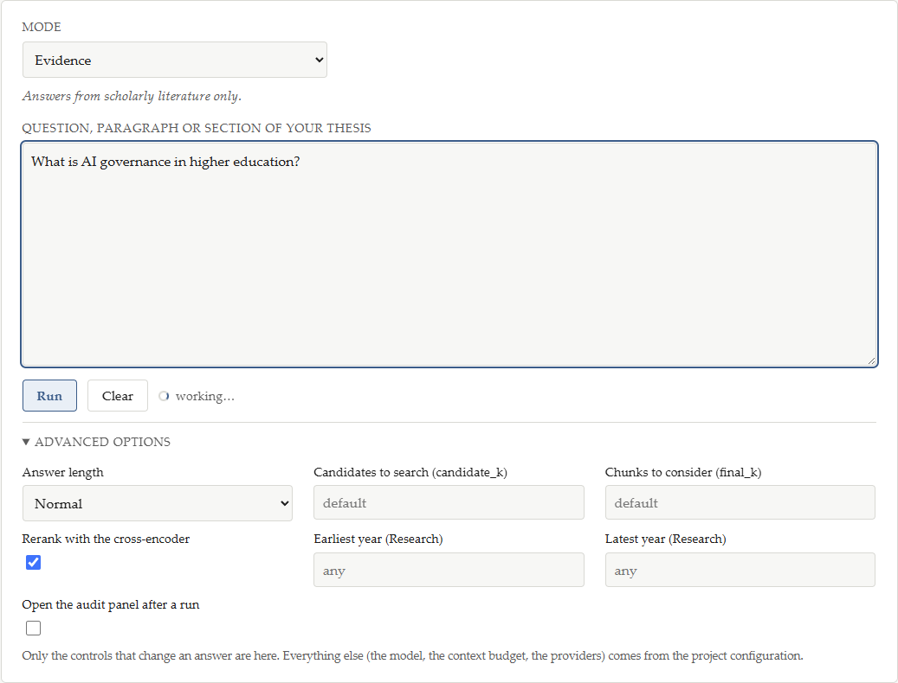

| Option | What it does | When to change it |
|---|---|---|
| **Answer length** | `concise` (3–5 sentences), `normal`, `detailed` | when the default answer is too long or too short. Evidence and Writing only |
| **Candidates to search (candidate_k)** | how many chunks the dense search retrieves before re-ranking (default 25) | raise it when you suspect relevant work exists that was not found; lower it for speed |
| **Chunks to consider (final_k)** | how many chunks the mode works from after re-ranking and de-duplication | raise it for a broader synthesis; lower it to keep the answer tight |
| **Rerank with the cross-encoder** | turns the local re-ranker on/off | off is faster and rougher; useful for a quick smoke test |
| **Earliest / latest year** | restrict external discovery to a year range | Research only, when you want only recent work (or only older, foundational work) |
| **Open the audit panel after a run** | expands the Audit panel automatically | while debugging a specific search |

Changing `candidate_k` is the single most useful lever when an answer says it found nothing or
missed a paper you expected — the search is not written by the model, so widening it is safe.

## 7. Copying into your thesis

Three buttons sit under the answer:

| Button | Copies |
|---|---|
| **Copy answer** | the validated prose, exactly as shown, paragraph breaks preserved |
| **Copy answer + references** | the prose, then a `References` heading and the bibliography |
| **Copy references** | the bibliography only (disabled when there are no references) |

The clipboard gets plain text, so it pastes into Word, Scrivener or Google Docs without
styling surprises. Two things to do before you keep the text:

1. Read the warnings and the validation details — a partially supported or uncertain claim
   carries a visible annotation you may want to resolve by reading the source first.
2. Check the `metadata_warning` flags on the references: they say what the corpus metadata
   does not contain (for example a missing DOI), so you can complete the entry yourself.

Nothing is ever written into your thesis files. The interface reads the corpus and returns
text; you decide what to keep.

## 8. Everyday recipes

**Answer a question with evidence, and check it before you use it**
1. Mode: **Evidence**.
2. Type the question, press Run.
3. Read the meta line: `12 claims (12 supported)` means every sentence was traced to a source.
4. If a warning says a claim was withheld, open **Validation details** and read that claim's
   card before deciding whether to rephrase the question.

**Check a paragraph you just wrote**
1. Paste the paragraph into the input box.
2. Mode: **Consistency**.
3. Read **Unsupported claims** first: those are sentences the retrieved literature does not
   cover — check the sentence, or widen the retrieval (`Advanced options → candidate_k`) and
   run again.
4. Then read **Style**: em dash, long sentences, promotional wording, against your own rules.

**Draft a paragraph that continues what you have**
1. Mode: **Writing**, question such as `Write a short PhD paragraph on X, consistent with my
   existing chapter.`
2. Your draft and your rules are in the context, so the terminology should feel continuous —
   but they are never cited, which is visible in the sources panel.

**See what the literature says that you do not**
1. Mode: **Consistency**, with a topic sentence or heading as the query.
2. Read the second terminology finding: *"the retrieved literature uses 8 term(s) your draft
   does not"* — that list is the vocabulary gap.

**Find new work**
1. Mode: **Research**, with a topic query.
2. In **Advanced options**, set *Earliest year* to the last few years.
3. Read **NEW EXTERNAL PAPERS** first; treat **POSSIBLE MATCHES** as candidates, not as
   confirmed papers.

**Check a methodology question against your guidance**
1. Mode: **Supervisor**, query `What guidance do I have about methodology?`
2. Read the labelled excerpts; nothing here is citable, which is the point.

**Verify a number you are about to quote**
1. Mode: **Consistency**, with the sentence containing the number.
2. A **Numeric discrepancy** finding means the closest literature passage states figures of the
   same kind but not that value — go and read the passage.

## 9. Troubleshooting
Everything the tool cannot do, it says in a notice at the top of the result, with the raw
detail collapsed underneath. Here is what each one means and what to do about it.

| What you see | What it means | What to do |
|---|---|---|
| Status bar: **Ollama unavailable** | the model server is not answering | start Ollama (`ollama serve`); check the base URL in your configuration |
| Status bar: **model … is not installed** | Ollama is up but does not have the configured model | `ollama pull qwen3.5:35b`, or start the interface with `--model <name>` |
| Status bar: **index unavailable** | the index cannot be read | build the index (RAG-008) or check the collection name |
| Status bar: **index in use — a run is in progress** | a run currently holds the index | wait; status is refreshed when you reload the page |
| Troubleshooting lock message in the notice: *"another process holds the local Qdrant store"* | the index is open somewhere else — almost always a running CLI command or a second interface window | close the other process (Ctrl+C), or point one of them at a Qdrant server |
| Notice: **Ollama is not reachable** | the model server went down mid-run | start it and run again |
| Notice: **The configured model is not installed** | Ollama answered but not for that model | pull the model, or run with `--model` |
| Notice: **The model took too long** | generation hit the configured timeout | use a shorter *answer length*, or raise the timeout in your configuration |
| Notice: **Nothing citable was retrieved** | no evidence-eligible literature matched the query — so no answer was invented | rephrase, or widen `candidate_k` |
| Notice: **The retrieved evidence was not enough to answer** | sources were found, but the model reported they do not cover the question | broaden the question, raise `candidate_k`, or check whether the corpus actually holds work on this |
| Chat notice: **The model could not answer** with *prediction aborted, token repeat limit reached* | Ollama's own runner has ended up repeating a single token, so its guard stopped the prediction. The chat already retried the turn once, with a fresh model load | press **Retry this turn** (your message is never sent twice), and if it fails again restart Ollama — that clears it. The context window is not the problem |
| Chat notice: **This message has no answer yet** | the last turn failed to generate; one user turn is stored and answerable | press **Retry this turn**; do not type the message again |
| Chat notice: **DeepSeek authentication failed** | the key configured on the server was rejected | check `DEEPSEEK_API_KEY` and restart the interface; meanwhile switch the **Model** list back to the local model and press **Retry this turn** |
| Chat notice: **DeepSeek rate limit reached** / **service is temporarily unavailable** / **request timed out** | the cloud provider refused or did not answer in time; nothing was retried automatically because a cloud request is billed | wait a moment, then press **Retry this turn** — or switch back to the local model. Your message is saved either way |
| Chat notice: **DeepSeek refused the request because the account balance is insufficient** | the account has no credit left | top up, or use the local model |
| Chat notice: **DeepSeek does not recognise the model …** | `DEEPSEEK_MODEL` names an id the provider does not offer | set it to an id DeepSeek lists and restart, or pick another entry in the **Model** list |
| Chat notice: **That model is not available** | the requested model is not one this installation offers | choose one of the entries in the **Model** list; the notice names the ids that are configured |
| Chat notice: **DeepSeek is not configured** | no key is set on the server | set `DEEPSEEK_API_KEY` and restart, or use the local model |
| Chat notice: **That file cannot be attached** / **too large** | the extension is not PDF/DOCX/TXT/MD, or the file is over the size limit | convert the file, or raise `PHD_RAG_CHAT_MAX_ATTACHMENT_BYTES` |
| Chat: a document was attached but the model ignores it | the attachment's text could not be extracted (chip says *could not be read*) | check the chip, re-attach a text-based copy (or a searchable PDF), and see *Context and debug* |
| Notice: **Nothing matched this query** | neither the corpus nor the providers returned anything | use different words; the corpus and the Internet indexes match on vocabulary |
| Notice: **N claim(s) were withheld as unsupported** | one or more sentences could not be traced to the source they cited, so they are not in the answer | open Validation details, read the withheld sentences, and decide whether to ask a narrower question |
| Notice: **The external providers did not answer** | Crossref/OpenAlex were unreachable | local results are unaffected; try Research again later |
| Notice: **Some evidence did not fit the context budget** | more sources were retrieved than the model's context could hold | ask a narrower question, or reduce the retrieved set (`final_k`), or raise the context budget in your configuration |
| Notice: **That request could not be read** | the request was rejected before running (for example `year_min` later than `year_max`) | correct the option and run again; the detail line names the field |
| The page looks out of date after an update | the browser cached the front-end files | hard-reload with `Ctrl+F5` |
| Nothing happens when you press `Enter` | `Enter` inserts a newline in the input box on purpose, because the box holds paragraphs | press **Run**, or `Ctrl+Enter` |

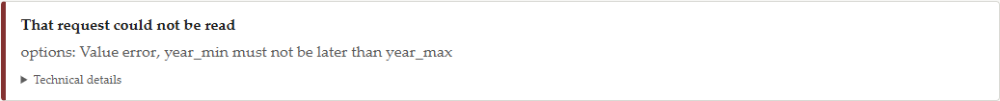

## 10. What this tool does not do

Being clear about this is part of using it well.

* **It does not decide whether a claim is true.** It decides whether the cited source supports
  it. "Unsupported" in Consistency means *no match was found in what was retrieved*, and
  "supported" means *the source contains the claim's content* — neither is peer review.
* **It does not read your mind about scope.** A question that is too broad will produce a
  broad answer from a handful of chunks; a question that is too narrow may retrieve nothing.
  The sources panel is where you check which of those happened.
* **It does not cite Internet metadata.** External records can point you at a paper; opening
  the paper and putting it in your corpus is what makes it citable.
* **It does not rewrite your text.** Consistency reports; it never edits.
* **It has no memory between runs.** No history, no follow-up questions, no "continue that
  paragraph from before". Each run starts fresh.
* **It does not stream.** The answer appears when the run finishes, so a detailed answer keeps
  the spinner for longer.
* **It has no upload.** You paste text; there is no file picker and no document management.
* **It is not multi-user and has no accounts.** One person, one machine.

## 11. Privacy and where things live

* The interface binds to **127.0.0.1** by default, so only your machine can reach it. Binding
  to `0.0.0.0` requires the explicit `--host 0.0.0.0` flag, and the start-up banner warns you
  when you do it.
* **Answers are produced by a local model.** Your questions, your drafts and the retrieved
  passages are not sent to any third party. The only outbound traffic is the metadata query
  that Research mode sends to Crossref and OpenAlex (public bibliographic APIs), which carries
  your search terms — nothing from your documents.
* **The one exception is deliberate and yours to make.** When you select DeepSeek for a
  message, that message's assembled context — instructions, the relevant part of the
  conversation, the text of the documents attached to the chat, and the corpus excerpts
  retrieved for that message — is sent to the DeepSeek API, and DeepSeek's answer is stored
  here. Everything else stays local: the rest of the corpus, the index, other chats, and the
  files themselves. There is no automatic fallback to DeepSeek, and the API key lives only in
  the server process, never in the page or the saved conversation.
* The `data/` directory holding the corpus is not tracked in git: it contains third-party
  published PDFs plus your own drafts and supervision material.
* **Your conversations are local too.** They live in `data\chat\chat.sqlite3` and
  `data\chat\attachments\`, inside the same untracked `data/` directory. Attachments are copies
  made for that conversation; they are never added to `data\literature` or `data\my_work`.
* The Advanced screen clears its panels when you press Clear and keeps nothing between runs;
  the chat is the one thing that is deliberately saved.

## 12. The same tasks from the command line

Every mode is also available as a command, which is useful for scripts, for reading the raw
JSON, and for when the interface is holding the index. The commands are in the README; the
short version:

| Task | Command |
|---|---|
| Evidence | `python -m app.modes.inspect evidence "…"` |
| Writing | `python -m app.modes.inspect writing "…"` |
| Consistency | `python -m app.modes.inspect consistency "…"` |
| Supervisor | `python -m app.modes.inspect supervisor "…"` |
| Research | `python -m app.modes.inspect research "…"` |
| Add `--show-sources`, `--show-audit`, `--json` | more detail, or machine-readable output |

Remember the one-process rule: stop the interface before running a mode from the command line,
because both want the same local index.

---

*Manual for RAG-014 with the RAG-015 simple chat. The mode screenshots in this manual were
taken from a real run against the real corpus (11,469 indexed chunks), the real model
(`qwen3.5:35b` through Ollama) and the real external providers; see
[`rag014-ui-validation.txt`](rag014-ui-validation.txt) for that validation record. The chat was
validated the same way — see [`rag015-validation.txt`](rag015-validation.txt).*
